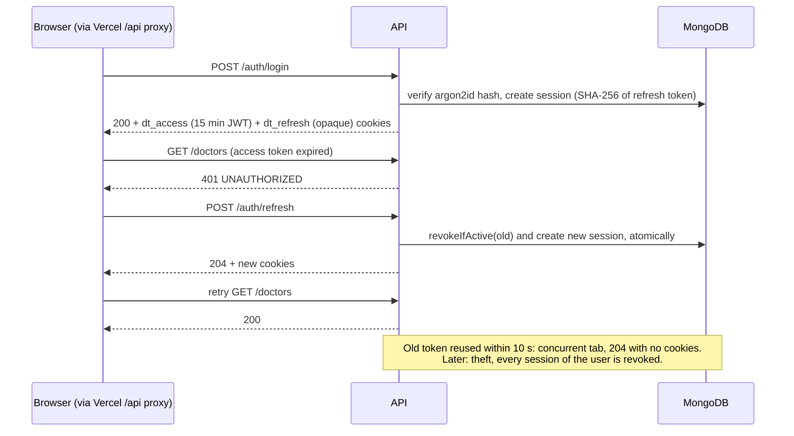
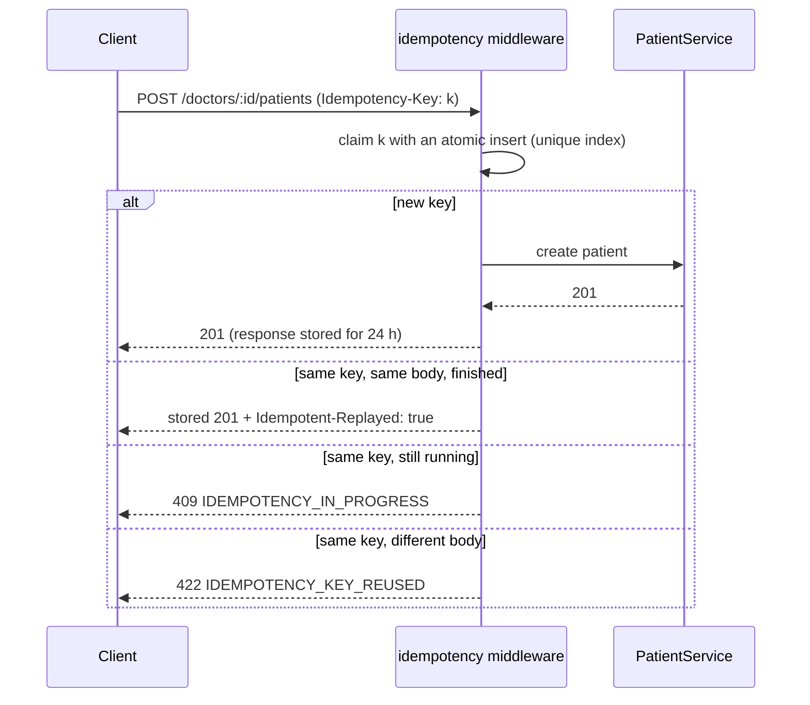
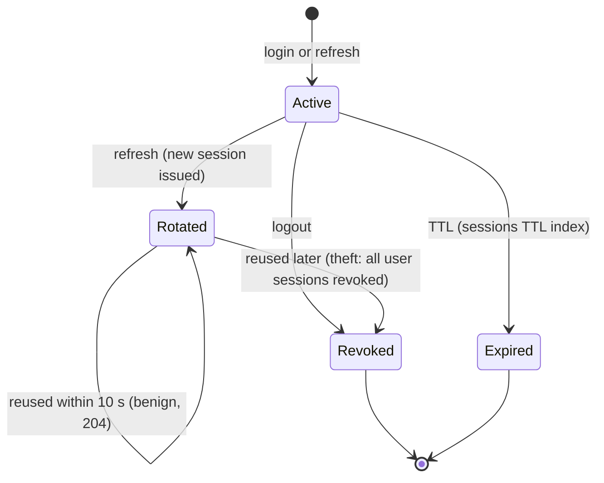
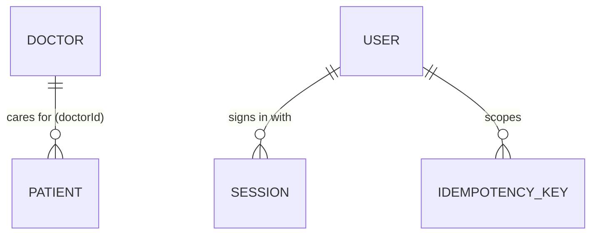
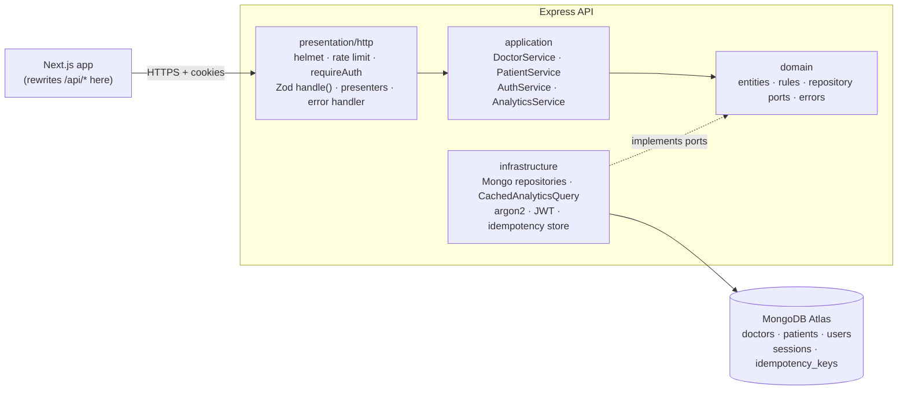
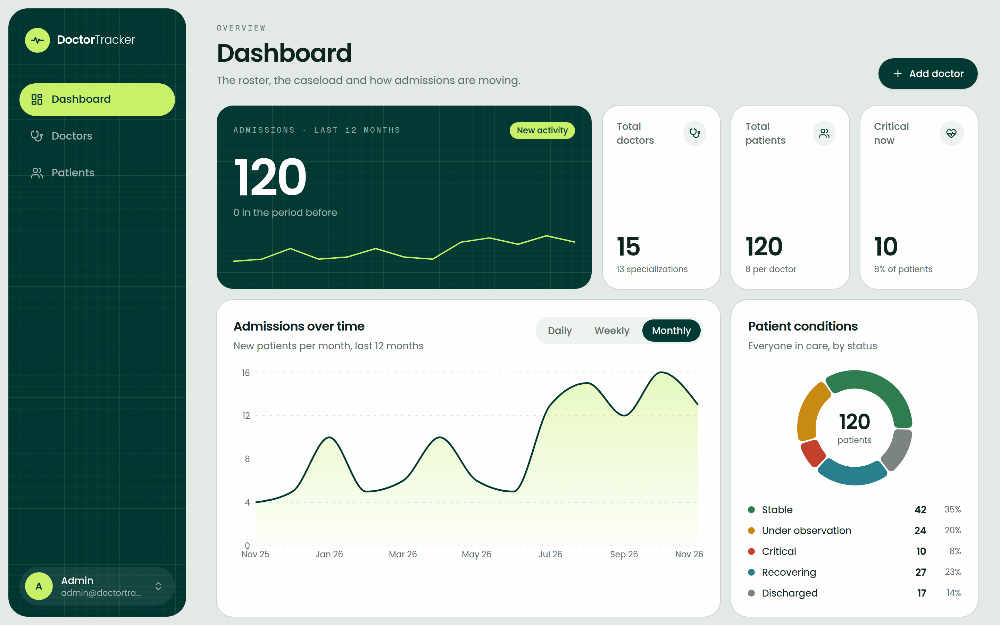
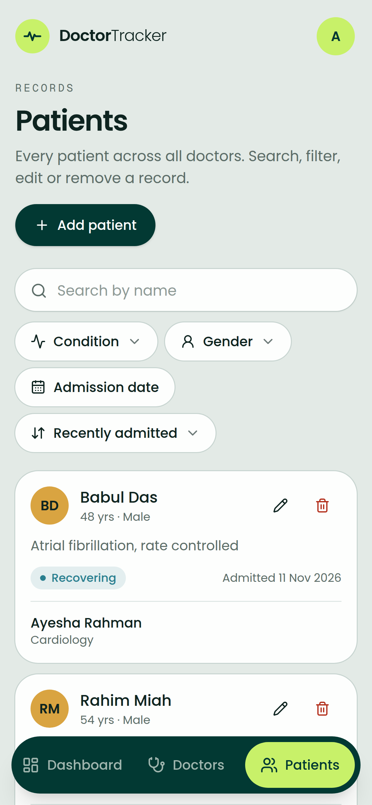
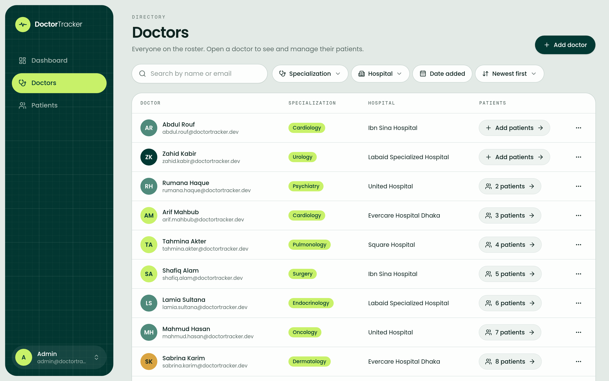
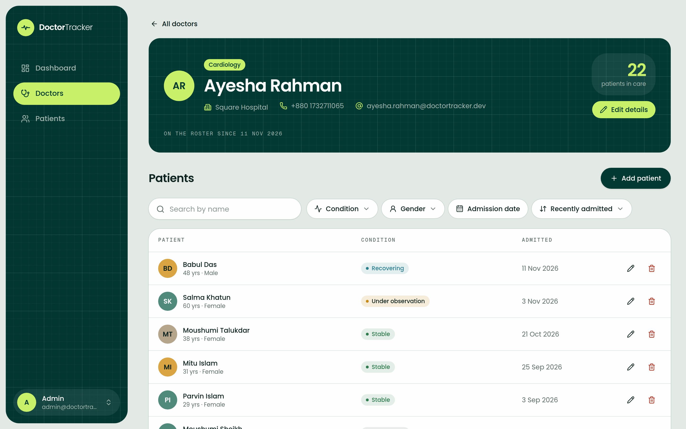

# Doctor Tracker · API

Doctor Tracker is a secure admin portal for clinics and hospital groups. An administrator signs
in, keeps the roster of doctors up to date, records each doctor's patients, and sees at a glance
how the caseload is moving. This repository is the **REST API** behind it: an Express 5 and
MongoDB service built with Clean Architecture. It handles cookie-based authentication with
rotating refresh tokens, indexed search, filtering and pagination, and the dashboard
aggregations. The Next.js frontend lives in a separate repository,
[doctor-tracker-web](https://github.com/SadeeMsr/doctor-tracker-web).

> **Live API:** <https://doctor-tracker-api-h4wm.onrender.com/api/v1/health>, used by the web app at
> <https://doctortracker-portal.vercel.app>. It runs on Render's free plan, which sleeps when idle,
> so the first request after a quiet spell can take up to a minute.

| Evaluation                                                                                       | Result                                                                                                                                                       |
| ------------------------------------------------------------------------------------------------ | ------------------------------------------------------------------------------------------------------------------------------------------------------------ |
| Backend requirements of the brief (auth, REST, indexing, query optimisation, validation, errors) | **All met** ([checklist](#backend-requirement-checklist))                                                                                                    |
| Live API, checked from outside                                                                   | Health 200 with the database up (261 ms); protected routes 401 with the error envelope; wrong credentials give one generic 401; HSTS and CSP headers present |
| Tests                                                                                            | **70 / 70** passing (12 files, about 2 s, no database needed)                                                                                                |
| End-to-end, through the web app                                                                  | 122 / 122 checks across every screen (see the [web README](https://github.com/SadeeMsr/doctor-tracker-web#2-how-this-was-evaluated))                         |

## Backend requirement checklist

|     | Requirement                                          | How                                                                                                                              | Proven by                                                                                        |
| --- | ---------------------------------------------------- | -------------------------------------------------------------------------------------------------------------------------------- | ------------------------------------------------------------------------------------------------ |
| ✅  | Only authenticated users                             | `requireAuth` on every router except `/health` and `/auth/*`; HS256 JWT with pinned algorithm                                    | `auth.http.test.ts` (forged and `alg: none` tokens rejected), live 401                           |
| ✅  | Secure login                                         | argon2id, httpOnly + `SameSite=Lax` + `Secure` cookies, rotating opaque refresh tokens, theft lockout, 10 failed logins / 15 min | `auth.http.test.ts` (12), `auth.service.test.ts` (8)                                             |
| ✅  | Doctor CRUD, search, filters, pagination             | `/doctors` with prefix search, multi-value specialization and hospital, date range, sort                                         | `doctors.http.test.ts` (10), `query-lists.test.ts`                                               |
| ✅  | Patients under a doctor, list, edit, delete, filters | `/doctors/:id/patients`, `/patients` with condition (multi), gender, date range                                                  | `patients.http.test.ts` (7)                                                                      |
| ✅  | Dashboard aggregation                                | `/analytics/summary`: 7 aggregates in parallel, zero-filled buckets, 30 s cache                                                  | `analytics.service.test.ts`, `time-buckets.test.ts`                                              |
| ✅  | Proper indexing, efficient queries                   | An index per filter and sort (ESR order); anchored prefix search; no per-row queries; `$lookup` after `$limit`                   | [index table](#2-an-index-for-every-query-rather-than-add-indexes-later), `prefix-regex.test.ts` |
| ✅  | Validation and error handling                        | Zod at the edge, one error envelope with stable codes and `requestId`                                                            | every HTTP test asserts status, `code` and `details`                                             |
| ✅  | Safe retries                                         | Unique email index; required `Idempotency-Key` on patient creates                                                                | `idempotency.http.test.ts` (8)                                                                   |

## Flows

**Login, refresh and rotation**



**Idempotent patient create**



**A refresh token's life**



**Data model today**



The many-to-many evolution (doctors, hospitals, affiliations, admissions) is in [Scalability considerations](#scalability-considerations).

**Known edge case:** if a client navigation aborts a refresh mid-flight, the browser keeps the old token, and reusing it after the 10 s grace window is treated as theft. Planned fix: when the replacement session has never been used, rotate again instead of revoking.

## Contents

- [Tech stack](#tech-stack)
- [Setup guide](#setup-guide)
- [API reference](#api-reference)
- [System architecture](#system-architecture)
- [Technical decisions](#technical-decisions)
- [Visual evidence](#visual-evidence)
- [Security](#security)
- [Scalability considerations](#scalability-considerations)

## Tech stack

| Concern    | Choice                                                                         |
| ---------- | ------------------------------------------------------------------------------ |
| Runtime    | Node.js 26 LTS, ESM only                                                       |
| Framework  | Express 5 (native async error forwarding)                                      |
| Language   | TypeScript 6, strict, with `noUncheckedIndexedAccess` and `erasableSyntaxOnly` |
| Database   | MongoDB (Atlas in production), Mongoose 9                                      |
| Validation | Zod 4 at the HTTP edge and for environment variables                           |
| Auth       | argon2id password hashing, HS256 JWT access tokens, opaque refresh tokens      |
| Hardening  | helmet, express-rate-limit, compression, CORS allow-list                       |
| Logging    | pino with request ids                                                          |
| Tooling    | ESLint 9 (enforces the layer rules), Prettier, Husky, lint-staged, commitlint  |

## Setup guide

### Prerequisites

- Node.js **26** (see `.nvmrc`) and pnpm **12**. With Corepack, run `corepack enable`.
- MongoDB 7+, either local (`mongodb://127.0.0.1:27017`) or a free MongoDB Atlas cluster.

### Steps

1. Clone and install:

   ```bash
   git clone https://github.com/SadeeMsr/doctor-tracker-api.git
   ```

   ```bash
   cd doctor-tracker-api && pnpm install
   ```

2. Create your environment file from the example and fill in the values:

   ```bash
   cp .env.example .env
   ```

   | Variable                    | Required | Default                   | Description                                                            |
   | --------------------------- | -------- | ------------------------- | ---------------------------------------------------------------------- |
   | `MONGODB_URI`               | yes      | none                      | `mongodb://` or `mongodb+srv://` connection string, `retryWrites=true` |
   | `JWT_ACCESS_SECRET`         | yes      | none                      | At least 32 random characters; signs the access JWT                    |
   | `NODE_ENV`                  | no       | `development`             | `production` turns on `Secure` cookies and hides error stacks          |
   | `PORT`                      | no       | `4000`                    | HTTP port                                                              |
   | `LOG_LEVEL`                 | no       | `info`                    | pino level                                                             |
   | `TRUST_PROXY`               | no       | `1`                       | Reverse proxies in front of the app (Render = 1, local = 0)            |
   | `CORS_ORIGINS`              | no       | `http://localhost:3000`   | Comma-separated; only direct browser calls need it                     |
   | `JWT_ACCESS_TTL_SECONDS`    | no       | `900`                     | Access token lifetime (15 min)                                         |
   | `REFRESH_TOKEN_TTL_SECONDS` | no       | `604800`                  | Refresh session lifetime (7 days)                                      |
   | `SEED_ADMIN_EMAIL`          | no       | `admin@doctortracker.dev` | Admin account created by `db:create-admin`                             |
   | `SEED_ADMIN_NAME`           | no       | `Admin`                   | Its display name                                                       |
   | `SEED_ADMIN_PASSWORD`       | no       | `Admin@12345`             | Its password; change it for any shared deployment                      |

   Generate a secret with:

   ```bash
   node -e "console.log(require('crypto').randomBytes(48).toString('base64url'))"
   ```

   The server validates the environment at startup and refuses to boot with a clear message if
   anything is missing or malformed.

3. Build once, then create the admin account. There's no public sign-up. Running it again
   resets the password.

   ```bash
   pnpm build && pnpm db:create-admin
   ```

4. Start the dev server (watch mode). In development, indexes are built automatically.

   ```bash
   pnpm dev
   ```

5. Check it's up:

   ```bash
   curl http://localhost:4000/api/v1/health
   ```

   Then start the [web app](https://github.com/SadeeMsr/doctor-tracker-web) and sign in.

### Scripts

| Command                        | What it does                                                         |
| ------------------------------ | -------------------------------------------------------------------- |
| `pnpm dev`                     | Watch mode with `tsx`, reading `.env`                                |
| `pnpm build` / `pnpm start`    | Compile to `dist/` and run it                                        |
| `pnpm db:sync-indexes`         | Create or drop indexes to match the models (production; after build) |
| `pnpm db:create-admin`         | Upsert the admin account from `SEED_ADMIN_*` (after build)           |
| `pnpm lint` · `pnpm typecheck` | ESLint (including layer boundaries) and `tsc`                        |

### Production (Render + Atlas)

- **Build command:** `pnpm install && pnpm build`
- **Start command:** `pnpm start`
- **Environment:** `NODE_ENV=production` and `TRUST_PROXY=1`, plus `MONGODB_URI` and
  `JWT_ACCESS_SECRET`.
- **Health check path:** `/api/v1/health`. It returns `503` when the database is unreachable.
- **One-off, after the first deploy:** run `pnpm db:sync-indexes` and `pnpm db:create-admin`
  from the Render shell.

## Tests

```bash
pnpm test
```

70 tests in about 2 seconds, with **no database**. Because every adapter sits behind a port, the HTTP tests run the real Express app, services and domain rules on in-memory fakes (`tests/support/in-memory-container.ts`).

- **Auth:** httpOnly/SameSite cookies, one generic login error, refresh-token rotation, the concurrent-tab grace window, token-theft lockout, idempotent logout, the login rate limit, and forged or `alg: none` JWTs.
- **Doctors and patients:** status codes and error envelopes (201 + `Location`, 404, 409, 422 with field paths), search, multi-value filters (`$in`; hospital names with commas), pagination, blocked deletion of a doctor with patients, and removing only a doctor's own patient.
- **Idempotency:** a retried create is replayed instead of duplicated, a reused key with a different body is rejected, and a 5xx is never stored.
- **Analytics:** % change against the previous window, zero-filled series, Monday-based weeks, and limits on chart size.

Husky runs the related tests on every commit and the full suite before every push; CI runs it too.

## API reference

The base path is `/api/v1`. Everything except `/health` and `/auth/login|refresh|logout` needs a
valid session cookie.

| Method   | Path                               | Description                                                                                                           |
| -------- | ---------------------------------- | --------------------------------------------------------------------------------------------------------------------- |
| `GET`    | `/health`                          | Liveness and database check                                                                                           |
| `POST`   | `/auth/login`                      | Email + password → sets `dt_access` and `dt_refresh` cookies (rate limited)                                           |
| `POST`   | `/auth/refresh`                    | Rotates the refresh token and issues a new access token                                                               |
| `POST`   | `/auth/logout`                     | Revokes the session and clears the cookies (always `204`)                                                             |
| `GET`    | `/auth/me`                         | The signed-in user                                                                                                    |
| `GET`    | `/doctors`                         | List · `search`, `specialization`, `hospital`, `from`, `to`, `sortBy`, `sortOrder`, `page`, `limit`                   |
| `POST`   | `/doctors`                         | Create (email is unique → `409` on duplicates)                                                                        |
| `GET`    | `/doctors/hospitals`               | Distinct hospital names, for the filter                                                                               |
| `GET`    | `/doctors/:id`                     | Detail, with `patientCount`                                                                                           |
| `PATCH`  | `/doctors/:id`                     | Partial update                                                                                                        |
| `DELETE` | `/doctors/:id`                     | Delete; `409` while the doctor still has patients                                                                     |
| `GET`    | `/doctors/:id/patients`            | That doctor's patients, with the same filters as `/patients`                                                          |
| `POST`   | `/doctors/:id/patients`            | Add a patient under the doctor (**`Idempotency-Key` header required**)                                                |
| `DELETE` | `/doctors/:id/patients/:patientId` | Remove a patient from that doctor's list                                                                              |
| `GET`    | `/patients`                        | List · `search`, `condition` (comma list), `gender`, `doctorId`, `from`, `to`, `sortBy`, `sortOrder`, `page`, `limit` |
| `GET`    | `/patients/:id`                    | Detail, with the doctor summary                                                                                       |
| `PATCH`  | `/patients/:id`                    | Partial update (including reassigning `doctorId`)                                                                     |
| `DELETE` | `/patients/:id`                    | Delete                                                                                                                |
| `GET`    | `/analytics/summary`               | Dashboard totals, condition breakdown, admissions over time, top doctors, by specialization                           |

**Response shapes**

- Success: `{ data }`
- Lists: `{ data: [...], meta: { page, limit, total, totalPages, hasNextPage, hasPrevPage } }`
- Errors: `{ error: { code, message, details?, requestId } }`

**Status codes:** `201` + `Location` on create, `204` on delete, `401`, `404`, `409 CONFLICT`
(with `details.fields`), `422 VALIDATION_ERROR` (with `details[].path`), `429`. Error codes are
a stable contract; the web app switches on `code`, never on `message`.

## System architecture



**What happens on a request** (for example, `GET /api/v1/patients?condition=critical&page=2`):

1. **Edge.** These middlewares run in order: request id, then the pino logger, helmet, CORS,
   compression, the JSON body parser (100 KB limit), the cookie parser, and the API-wide rate
   limiter.
2. **Auth.** `requireAuth` verifies the `dt_access` JWT statelessly, with the algorithm,
   issuer and audience pinned. That needs no database read per request.
3. **Validation.** `handle(schemas, fn)` parses `params`, `query` and `body` with Zod, so the
   controller receives typed, validated input. A bad request becomes `422` with field paths.
4. **Use case.** The controller calls the application service. Services depend only on domain
   ports, and they throw domain errors (`NotFoundError`, `ConflictError`), never HTTP ones.
5. **Persistence.** The Mongo adapter builds an index-backed query: `lean()`, an explicit
   projection, and the page plus `countDocuments` run in parallel. It maps documents to plain
   entities with string ids.
6. **Response.** A presenter shapes the JSON (ISO dates, no `_id`). Any thrown error goes to
   the single error handler, which maps it to the status, `code` and `requestId` envelope and
   logs it once.

`src/container.ts` is the composition root: the only file that picks concrete adapters.
`createApp()` receives every dependency as an argument, so any port can be swapped for an
in-memory fake.

## Technical decisions

### 1. Clean Architecture with ports, enforced by the linter

**Problem.** In a typical Express app, route handlers talk to Mongoose models directly. It's
quick at first, but business rules end up mixed with HTTP and database details, Mongo error
codes leak into controllers, and nothing can be tested without a database.

**Decision.** Four layers, with dependencies that only point inward:

| Layer            | Contains                                                                     | May import               |
| ---------------- | ---------------------------------------------------------------------------- | ------------------------ |
| `domain`         | entities, normalisation rules, repository **ports**, domain errors           | nothing outside `domain` |
| `application`    | services (use cases), read-side ports (`AnalyticsQuery`, `IdempotencyStore`) | `domain`                 |
| `infrastructure` | Mongoose models and repositories, argon2, JWT, logger                        | `domain`, `config`       |
| `presentation`   | Express routers, Zod schemas, controllers, presenters                        | `domain`, `application`  |

ESLint's `no-restricted-imports` fails the build if, say, a service imports `mongoose` or a
controller imports `config`.

**Consequences.**

- **Business rules live in one place.** For example, "a doctor who still has patients can't be
  deleted" sits in `DoctorService.delete`, independent of HTTP or Mongo.
- **Infrastructure concerns stay in infrastructure.** Repositories translate `E11000` to
  `ConflictError` and return `null` for malformed ids, so the outer layers never see Mongo
  error codes or `ObjectId`.
- **Cross-cutting features are decorators, not edits.** The 30-second analytics cache is a
  `CachedAnalyticsQuery` wrapped around the Mongo adapter in `container.ts`. Neither the
  service nor the adapter knows it exists. Moving it to Redis means swapping one class.
- **Every feature has the same shape.** Each vertical slice follows the `doctors` template
  (entity → port → service → model/repository → schemas/controller/routes → container), so a
  new feature looks like the existing ones.
- **Trade-off:** more files and some mapping code (`toEntity`, presenters) than a
  "fat route" app. In return, each piece is small, has one reason to change, and can be tested
  with an in-memory fake.

### 2. An index for every query, rather than "add indexes later"

**Problem.** The brief grades query optimisation for search, filtering, pagination and
dashboard aggregation. The common pitfalls are:

- an unanchored `/term/i` regex, which scans the whole collection and can't use an index;
- a filter or sort with no index behind it;
- N+1 lookups for counts per row;
- aggregations that join before they limit.

**Decision.** Every filter and sort an endpoint exposes has an index, ordered Equality → Sort →
Range (ESR), and each index has a comment in its model file saying which query it serves:

| Collection       | Index                                             | Serves                                                 |
| ---------------- | ------------------------------------------------- | ------------------------------------------------------ |
| doctors          | `{ email: 1 }` unique                             | identity, duplicate protection, email-prefix search    |
| doctors          | `{ nameLower: 1 }`                                | case-insensitive name-prefix search and name sort      |
| doctors          | `{ specialization: 1, createdAt: -1 }`            | specialization filter, sorted and date-ranged          |
| doctors          | `{ hospital: 1, createdAt: -1 }`                  | hospital filter, sorted and date-ranged                |
| doctors          | `{ createdAt: -1 }`                               | default order and "date added" range                   |
| patients         | `{ doctorId: 1, admittedAt: -1 }`                 | a doctor's patient list and per-doctor counts          |
| patients         | `{ condition: 1, admittedAt: -1 }`                | condition filter (`$in`), sorted and date-ranged       |
| patients         | `{ gender: 1, admittedAt: -1 }`                   | gender filter                                          |
| patients         | `{ admittedAt: -1 }`                              | default order, admission date range, time-series stats |
| patients         | `{ nameLower: 1 }`                                | name-prefix search and name sort                       |
| sessions         | `{ tokenHash: 1 }` unique, `{ expiresAt: 1 }` TTL | refresh lookup; expired sessions delete themselves     |
| idempotency_keys | `{ key: 1 }` unique, `{ createdAt: 1 }` TTL       | atomic claim; keys expire after 24 h                   |

**Query patterns that go with the indexes**

- **Search** is an anchored, escaped, case-insensitive _prefix_ match (`^term`) on a
  denormalised `nameLower` field that the repository keeps in sync. That turns search into an
  index range scan instead of a collection scan. User input is never compiled into a regex
  unescaped.
- **Pagination** runs `find().skip().limit()` and `countDocuments()` in parallel. It always uses
  `lean()` with an explicit projection, and adds `_id` as a sort tie-breaker so pages are
  stable.
- **No N+1.** Each doctor's `patientCount` on a page comes from one grouped
  `countByDoctorIds` aggregation. The patient list joins its doctor with `$lookup` _after_
  `$skip`/`$limit`, so the join runs for at most one page of rows.
- **Dashboard.**
  - `AnalyticsService` runs every aggregate in parallel.
  - Totals use `estimatedDocumentCount()`, which reads collection metadata in O(1).
  - Date-ranged counts and the admissions time series `$match` on the `admittedAt` index first,
    then bucket with `$dateTrunc`. The service fills empty buckets with zeros, so charts don't
    have gaps.
  - "Top doctors" sorts and limits before its `$lookup`.
  - Results are cached for 30 s per process.
- **Production builds indexes deliberately.** `autoIndex` is off in production, and
  `pnpm db:sync-indexes` applies the model definitions on purpose, so a deploy never starts an
  unplanned index build on a live cluster.

**Trade-off:** extra indexes cost write throughput and storage. For an admin tool, which reads
far more than it writes, that's the right balance. Prefix search doesn't match words in the
middle of a name; if that's ever needed, the next step is an Atlas Search index, not an
unanchored regex.

### Also worth noting: retries can't create duplicates

- **Doctors** are protected by the unique email index.
- **Patients** have no natural key, so `POST /doctors/:id/patients` requires an
  `Idempotency-Key`.
  - The middleware claims the key with an atomic insert _before_ running the handler, so
    there's no check-then-insert race.
  - It stores the response, replays it for the same key and body, and returns `422` if the key
    is reused with a different body.
- **PATCH** only assigns absolute values, and **DELETE** leaves the same state when repeated.
  So double-clicks, flaky mobile networks and the client's refresh-and-retry are all safe.

## Visual evidence

The API has no UI of its own; these are screens of the web app it powers. More are in the
[web README](https://github.com/SadeeMsr/doctor-tracker-web#visual-evidence).

| Dashboard (desktop)                                                       | Patients (mobile)                                                                       |
| ------------------------------------------------------------------------- | --------------------------------------------------------------------------------------- |
|  |  |

| Doctors (desktop)                                                  | Doctor detail (desktop)                                                    |
| ------------------------------------------------------------------ | -------------------------------------------------------------------------- |
|  |  |

## Security

- **Passwords** are hashed with argon2id. Login verifies against a dummy hash for unknown
  emails, so response timing doesn't reveal which accounts exist. Every login failure returns
  the same message, and login is limited to 10 failed attempts per 15 minutes per IP.
- **Access token:** an HS256 JWT valid for 15 minutes, with `iss`, `aud` and `sub` claims. The
  algorithm is pinned when verifying.
- **Refresh token:** an opaque 32-byte random string. Only its SHA-256 hash is stored, in a
  TTL-indexed `sessions` collection.
- **Rotation:** every refresh rotates the token in one conditional atomic update.
  - A rotated token presented again within 10 s is treated as a concurrent tab.
  - Later than that, it's treated as theft, and all of that user's sessions are revoked.
- **Cookies** are `httpOnly`, `SameSite=Lax` (the CSRF defence), and `Secure` in production.
  Tokens never appear in response bodies.
- **Input:** every input is validated with Zod at the edge, and JSON bodies are capped at
  100 KB. helmet sets the security headers, and an API-wide rate limit applies.
- **Errors** never expose stack traces in production or echo raw input. Every error carries a
  `requestId` that matches its log line.

## Scalability considerations

- **The API is stateless.** Access tokens are verified without a database read, and sessions
  and idempotency keys live in MongoDB, so the API can run as many instances as needed behind a
  load balancer. Two things are kept per process today and would move to Redis when scaling
  out: the rate-limit counters and the 30 s analytics cache. Both are already behind an
  interface or a decorator.
- **Database.**
  - The indexes above keep list queries proportional to the page size, not the collection
    size.
  - For very deep pages, offset pagination would switch to keyset (cursor) pagination on the
    existing `(field, _id)` sort.
  - Analytics could move to a read replica or pre-aggregated daily rollups if the patient
    collection grows into the millions.
- **Data model growth.** Today a doctor has one specialization and one hospital, and a patient
  has one doctor, which matches the brief. For a real hospital group, the model would become
  FHIR-style:
  - `Doctor`
  - `Hospital`
  - `Affiliation` (doctor × hospital × department, like a FHIR PractitionerRole)
  - `Patient`
  - `Admission` (like a FHIR Encounter), with an embedded care team

  Recording the department on the admission keeps per-department statistics from
  double-counting patients who see several doctors. Clean Architecture keeps that change inside
  new domain slices and repositories, without touching the HTTP layer or other features.

- **Operations.** The process is crash-only: it exits on unhandled errors so the platform
  restarts it, shuts down gracefully on `SIGTERM`, and reports database health on `/health`.
  Logs are structured with request ids.

`AGENTS.md` holds the full conventions: layer rules, HTTP and error contracts, idempotency,
MongoDB query rules and security.
